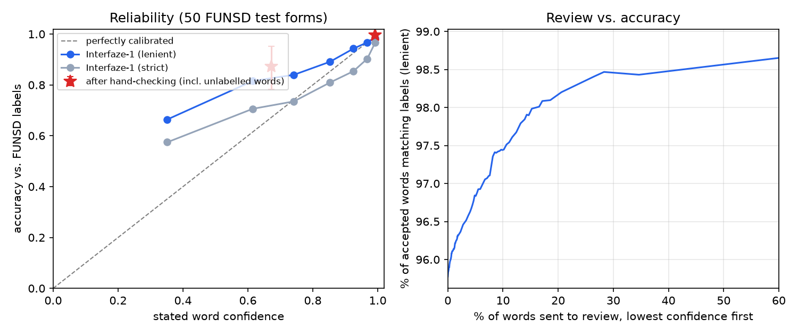

# Can you route on Interfaze's OCR confidence?

Interfaze's OCR returns a confidence score for every word. Its homepage suggests using it: *"send low-confidence values to review instead of trusting them blindly"* ([interfaze.ai](https://interfaze.ai)). Its `llms.txt` says the raw OCR in `precontext` *"is what you want for auditing or confidence thresholds."* This repo checks how well those scores track whether a word is actually right. It uses word-level labels from a public dataset, plus a hand check of the disagreements.

**Setup:** `interfaze-1` with the `<task>ocr</task>` system prompt, keyless API, one call per image, run on 2026-11-27. Scores are the per-word `confidence` values in `precontext`, the uncorrected raw OCR, not the model's corrected structured output. Data: the 50 test forms of [FUNSD](https://guillaumejaume.github.io/FUNSD/), noisy scanned business forms from the 1980s and 90s. 8,191 predicted words were scored against the labels.



## Findings

1. **At the top, the scores are about right, and the labels make it look worse.** 65% of words come back at confidence ≥ 0.99, and 98.4% of them match the FUNSD labels. I hand-checked 37 of the disagreements in that band against the image:
   - 27 were mistakes in the labels. For example, the page says `638-6532` where the label has `638-5532`, `75.3g/100` where it has `75.330g/100`, and `83553333` where it has `8355333`.
   - 8 were real OCR errors.
   - 2 were ambiguous.

   Counting by words, that puts real accuracy in this band at an estimated **99.6%** (95% range 99.2–99.9%), against a stated mean of 99.2%.

2. **Below 0.9, the scores understate accuracy by about 20 points.** This band is 1,362 words: 1,172 scored against labels and 190 with no label under them. Their mean stated confidence is 0.67.
   - Scored words: of 39 hand-checked disagreements, 14 were OCR errors, 17 label errors, 6 ambiguous and 2 matching artifacts. Estimated real accuracy is 92%.
   - Unlabelled words: of 30 hand-checked, 18 were real text read correctly, 2 misread, 6 specks or lines read as characters, and 4 ambiguous.

   Together the band is an estimated **87% correct (78–95%)**. Even the low end of that range is well above the stated 0.67. Confidence still ranks words usefully here, since the real error rate below 0.9 is many times the rate above 0.99. But the numbers themselves don't mean what they say, so a threshold picked from the docs' advice is hard to reason about.

3. **The ranking is useful.**
   - AUROC for separating right from wrong words is 0.78 [0.73, 0.83] against the labels.
   - A form's mean confidence tracks its error rate (Spearman −0.62 across the 50 forms).
   - Expected calibration error against the labels is 0.023 [0.017, 0.032].

   Most of that error sits in the low band.

4. **Text is duplicated when one word is split into two boxes.** A printed `NO.:` comes back as `NO` (0.99) followed by a narrow box reading `NO.:` (0.83–0.89), so the joined text is `NONO.:`.
   - An automatic check flags 9 cases in 2 of the 50 forms. Eight are on one fax log that repeats the field; the ninth is `Inc` + `Inc..` for a printed `Inc.` followed by a speck.
   - The check is conservative. The hand check found another case it misses: `37` returned as `3737`.
   - In all 9 flagged cases the duplicate box scored below 0.9, so a 0.9 threshold would catch them.

   This is from one run per image, so I haven't confirmed it repeats on a second call.

5. **Checkboxes come back in several formats.** Out of 40 checkboxes: `[ ]` ×28, `[x]` ×6, and `[]`, `[`, `I`, `x`, `B`, `xx` once each. Anyone parsing forms has to handle all of them.

6. **Strict text comparison against FUNSD mostly measures label conventions.** All 16 sampled disagreements that differ only in case or punctuation were label conventions or label errors; FUNSD often drops trailing punctuation. Strict accuracy is 91.8% and lenient is 95.8%. A strict FUNSD score would understate any good OCR model.

More detail:
- Full tables: [`results/REPORT.md`](results/REPORT.md).
- Per-word scores: [`results/word_scores.csv`](results/word_scores.csv).
- Every hand-check verdict, with form and box so anyone can dispute it: [`results/adjudication.csv`](results/adjudication.csv).

## What I'd change

- **Recalibrate the low end of the scale on a clean labelled set** (for example isotonic regression per document type), so a threshold like 0.9 means what it says. **Publish recommended review thresholds** per task. Fitting the map to FUNSD would not work, because it would mostly learn FUNSD's label errors.
- **Stop repeating text across split boxes** (finding 4), or merge the boxes.
- **Return checkboxes in one documented form**, for example `☐`/`☑` or a `checkbox: true/false` field.

Two small developer-experience points from running this:

- **No response header shows the keyless daily quota.** The `X-RateLimit-*` headers track the 50 requests/second limit, so they read 47–49 throughout. The only signal that the 50-per-day keyless quota is used up is the `keyless_daily_limit_exceeded` error on the next request.
- **`llms.txt` contradicts the docs on API keys.** It tells agents *"Interfaze requires an API key to work"*, but the [Limits](https://interfaze.ai/docs/limits) page and FAQ say keyless calls are allowed. Agents that read `llms.txt` will ask users for a key they don't need.

## Run it

Needs Python 3.10+. No dependencies; matplotlib is optional and only draws the figure.

```bash
make check      # tests, plus rebuilding every published number from results/*.csv (no API calls)
```

To reproduce from scratch, run the steps below. `make collect` makes 50 API calls, which fits the keyless daily limit; set `INTERFAZE_API_KEY` to use a key instead.

```bash
make data       # downloads FUNSD into data/
make collect    # calls Interfaze once per test image, caches raw responses in raw/
make analyze    # scores, writes results/
make sheets     # draws a random sample of disagreements as labelled crops in sheets/, for hand checking
```

## How words are matched

Interfaze and FUNSD split text differently: Interfaze may return `Fax:614-466-5087` as one word where FUNSD has two. So the matching works on groups:

- Predicted and labelled boxes that overlap (intersection ≥ 50% of the smaller box) are joined into groups.
- A group is correct when its predicted text, read in row order, equals its labelled text. Every predicted word in a group shares the group's label.
- **Lenient** ignores case, punctuation and underscores. **Strict** compares exact text after Unicode normalisation.
- Left out of the scores: predicted words with no labelled box under them (317, of which 190 are below 0.9 and covered by the hand check above), and checkboxes (40).
- 42 labelled words had no predicted word over them. A confidence threshold cannot catch those, because there is no word to score.

## Limitations

- **One dataset**, of old scanned English forms. Results on clean PDFs, receipts, handwriting-heavy pages or other languages could differ.
- **One run per image.** Interfaze also claims consistency; repeat-run agreement is not measured yet because the keyless limit is 50 requests a day. `python -m ocr_trust.client ... --run 2` collects a second run.
- **One person (me) did the hand check**: 130 crops, of which 122 still count under the current matching rules. The verdicts are in `results/adjudication.csv`.
- **The hand-checked samples are clustered.** The 37 high-band items come from 23 forms, and 4 of the 8 high-band OCR errors are on one fax log. The ranges resample whole forms to allow for this.
- **The estimates are ratio estimates** from samples of 30–39 items, so the ranges are wide, especially for the unlabelled words. Words between 0.90 and 0.99 were not hand-checked.
- **Lenient matching counts `1.5` and `15` as equal.** That can hide real errors in numbers, and some of the low-band disagreements it ignores are real.
- **Labels are per group**, so a correct word next to a wrong one in the same group is counted wrong (for example the correct `NO` in finding 4).
- **Raw API responses are not included**, because Interfaze's terms restrict redistributing output. The CSVs hold confidences, boxes and right/wrong labels, which is enough to rebuild every number here.
- **FUNSD is for non-commercial research use.** It is downloaded from its source, not redistributed.

Not affiliated with Interfaze.
