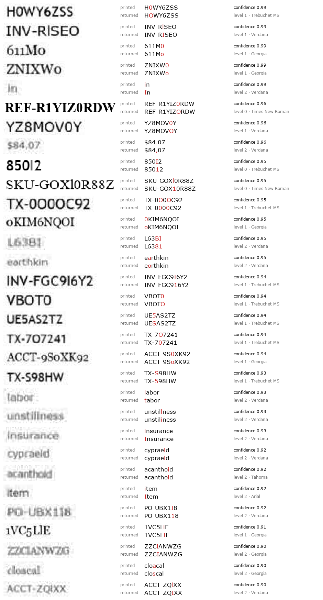

# Sure and wrong: Interfaze's OCR confidence on ID codes

Interfaze's homepage suggests using its OCR confidence to *"send low-confidence values to review instead of trusting them blindly"* ([interfaze.ai](https://interfaze.ai)), and its `llms.txt` says the raw OCR in `precontext` *"is what you want for auditing or confidence thresholds."* I tested that advice on generated pages where the right answer for every word is known exactly, and on real scanned forms.

For ordinary words the advice works. For ID codes such as invoice and account numbers, it doesn't: Interfaze confidently swaps look-alike characters, and a second call returns the same answer.



*Every word Interfaze got wrong at confidence ≥ 0.9 on the exact-label pages. Left: the page as scanned. Right: the printed text and what came back, with the differences in red.*

## Findings

1. **For words, confidence is about right.** On the exact-label pages, 10 of the 2,495 non-code words accepted at confidence ≥ 0.9 are wrong (0.4%). On real scanned forms (FUNSD), words at ≥ 0.99 are about 99.6% right once label errors are taken out by hand.

2. **For codes, it overstates.** 21 of the 147 ID codes accepted at ≥ 0.9 are wrong: **14%** (95% page-bootstrap interval 7–21%), more than ten times the rate for other words (interval 14–157×).
   - The accepted codes average 0.97 confidence but are 86% right.
   - At ≥ 0.99, 4 of 76 codes are wrong, against 1 of 2,063 other words.
   - Of the 31 confident errors, 24 are look-alike swaps (`0`/`O`/`o`, `1`/`I`/`l`, `5`/`S`, `8`/`B`), 3 are capitalisation changes (`in` → `In`), 1 is punctuation (`$84.07` → `$84,07`) and 3 are other misreads.

3. **The page didn't make these impossible.** In all 31 cases, Interfaze read both characters of every swap correctly elsewhere on the same page, in the same font, a median of 21 times each. On the page where it read `TX-0O0OC92` as `TX-0000C92`, it read `0` correctly in 15 other places and `O` in 4.

4. **Asking again doesn't catch them.** All 31 came back identically on a second call. Across 4,770 words sent twice, confidence never changed between calls, not even for the 24 words whose text did: `Scattle` and `Seattle` both scored 0.61 for the same word. So the score doesn't describe the string it is attached to.

5. **A small recalibration moves review toward codes.** The recalibration has four fitted numbers and uses two features already in the response: whether a word mixes letters and digits, and its share of look-alike characters. It reviews the same number of words as a plain threshold. The models were fitted and scored on different pages, and intervals resample pages.
   - **At the budget of a 0.9 threshold,** confident errors fall from 31 to 22 (change −17 to −2). Code errors fall from 21 to 7; other errors rise from 10 to 15.
   - **At the budget of a 0.95 threshold,** confident errors fall from 14 to 9 (−10 to +1, so not clearly fewer). Code errors fall from 11 to 3; other errors rise from 3 to 6.
   - **On FUNSD,** which was never used to fit the weights, error ranking improves: AUROC 0.781 → 0.807, gain 0.011–0.041. That is a general ranking gain; FUNSD has too few codes to test the code result.

## What I'd change in Interfaze

- **Make confidence aware of look-alike characters in codes.** A per-character confidence, or the runner-up character, would show a code's weakest position. Today a code's score looks like a word's score but is much less reliable.
- **Say what the score measures.** It stays fixed when the returned text changes between calls, so it is not the probability that this string is right. Users choosing a review threshold need to know what it is.
- **Smaller output fixes:**
  - Don't repeat text when one printed word is split into two boxes (`NO` + `NO.:` → `NONO.:`).
  - Return checkboxes in one documented format. I saw 8 renderings, some of them misreads: `[ ]`, `[x]`, `[]`, `[`, `I`, `x`, `B`, `xx`.
  - Keep returning boxes on very degraded pages: on the worst synthetic pages, 366 of 946 words came back with no bounds.

Two developer-experience points:
- No response header shows the keyless daily quota. The `X-RateLimit-*` headers track the 50 requests/second limit, so the first sign that the 50-per-day quota is gone is an error.
- `llms.txt` tells agents *"Interfaze requires an API key to work"*, but the [Limits](https://interfaze.ai/docs/limits) page and FAQ say keyless calls work.

## Objections I expected

**"Synthetic pages aren't real documents."**
Exact labels need generated pages: FUNSD's labels have errors, and those errors are larger than the effects measured here. FUNSD can't test the code result directly, because it has few codes: of 87 letter-and-digit tokens at ≥ 0.9, 4 disagree with the labels and none is a look-alike swap. What FUNSD does show:
- Look-alike swaps happen at 0.99 on real scans too, in words: `lowa` for *Iowa*, `Retall` for *Retail*.
- The recalibration's features improve error ranking on real forms.

**"Your IDs are adversarial."**
They are random strings. About half of their characters come from the look-alike set, and they have no structure, so no prior helps. That is deliberate, and it makes the 14% an upper-end rate rather than a typical one.

The finding is the gap between codes and words at the same confidence. Real formats do mix these characters; VINs leave out I, O and Q precisely because of this confusion. Some of my codes contain a lowercase `l`, which real all-caps codes rarely do. Leaving those out, 16 of 141 confident codes are still wrong (11%).

**"Some of those characters look identical in some fonts. Georgia's 0 looks like an o."**
The model itself is the evidence: on each of those pages it reads both characters correctly elsewhere (finding 3). Georgia's old-style `0` read as `o` accounts for 4 of the 21 code errors, and on those pages Interfaze read `0` correctly 14–15 times and `o` 61–87 times.

As a second, weaker check, [`confident_errors.csv`](results/synth/confident_errors.csv) gives each error's d′. That is the separation between the two characters for a template matcher that knows the font, in units of the noise on that word's ink. Every error on a noisy page scores at least 4.3. It assumes the font is known and the noise is white, so it describes the image rather than giving a probability. Either way, a near-tie should not score 0.99.

**"Your labels are wrong" / "you checked them yourself."**
The synthetic labels come from the code that drew the text. A test checks, on one page per level, including rotated pages, that no ink falls outside the label boxes and every box contains ink. For FUNSD, all 130 hand-check verdicts are published with form and box (122 still count under the current matching rules).

**"15 pages is small."**
Intervals resample whole pages. The code result rests on 147 confidently accepted codes:
- 14 of the 21 code errors are on level-1 pages.
- Fonts aren't balanced across levels: level 0 is Times and Trebuchet only; Georgia and Verdana appear only at levels 1–2.
- More pages would tighten this. The keyless API allows 50 calls a day.

**"`precontext` is the raw OCR; the model's final answer is corrected."**
`precontext` is where the confidence lives, and Interfaze's `llms.txt` points there for thresholds. I didn't test whether the structured output repairs codes. That depends on the prompt, and it carries no score to threshold on.

**"You chose the calibrator using FUNSD."**
Partly. The weights never saw FUNSD. But I added the two small feature sets after seeing the 12-feature model do worse than nothing on FUNSD, so FUNSD is not a clean test of which features to use. The small model is also the best of the four out of fold on the synthetic pages (AUROC 0.922 against 0.916 and 0.912). Its look-alike character set is the same one the code generator over-samples. All four models are reported.

**"Is this the production model, and was the second call cached?"**
Every one of the 100 responses reports `"model": "interfaze-1"`. Calls were made on 27 November 2026, Pacific time. FUNSD run 1 was at 01:00. The keyless quota resets at 00:00 UTC (16:00 Pacific), and the rest ran after that.

The synthetic second run came minutes after the first, so server-side caching can't be ruled out there. The FUNSD repeats were 15 hours apart and show the same pattern. Each page was sent twice, not more.

## Details

### Exact labels, by field type

15 synthetic pages (levels 0–2), 3,086 words, each scored against its exact label. A *silent error* is a wrong word at or above the review threshold, so nobody looks at it. Intervals are 95% page-bootstrap intervals. Full tables: [`results/synth/REPORT.md`](results/synth/REPORT.md).

| field | words | accuracy | mean confidence | accepted at ≥ 0.9 | silent errors | wrong among accepted |
|---|---|---|---|---|---|---|
| ID code | 256 | 77.7% | 85.4% | 147 | 21 | **14.3%** (7.3–20.9%) |
| amount | 233 | 96.1% | 92.7% | 180 | 1 | 0.6% (0–2.0%) |
| common word | 1,166 | 99.2% | 96.7% | 1,074 | 4 | 0.4% (0.1–0.9%) |
| rare word | 912 | 96.8% | 94.9% | 779 | 5 | 0.6% (0.1–1.4%) |
| field label | 225 | 99.6% | 95.8% | 198 | 0 | 0% |
| quantity | 205 | 99.5% | 96.8% | 192 | 0 | 0% |
| date, phone, email | 88 | 100% | 92.8% | 72 | 0 | 0% |

One more word, whose match group spans two fields, is in the report but not this table.

By level:

| level | page | words right |
|---|---|---|
| 0 | clean render, 150 dpi | 99.7% |
| 1 | light scan, about 112 dpi | 98.4% |
| 2 | rotated, faded scan, about 82 dpi | 91.6% |

Level-3 pages (about 67 dpi, with speckle) are left out of every number. Interfaze reads only 6% of their words correctly, but it says so: mean confidence is 0.32, and 0.2% of words reach 0.9. It returns 366 of their 946 words with no bounds, so word-level scoring is not meaningful there.

### The confident errors

[`results/synth/confident_errors.csv`](results/synth/confident_errors.csv) has one row per error, with these columns:
- the edits, and the category (look-alike, capitalisation, punctuation, other);
- font and level;
- `read_right`: how often each swapped character was read correctly elsewhere on the page;
- d′;
- whether the second run repeated it.

21 of the errors are ID codes, 5 rare dictionary words, 4 common words and 1 amount.

### Repeat runs

[`results/synth/consistency.json`](results/synth/consistency.json), [`results/funsd/consistency.json`](results/funsd/consistency.json)

| | words paired across runs | same confidence | text changed | changed, same confidence > 0.5 |
|---|---|---|---|---|
| synthetic, levels 0–2 | 3,086 | 100% | 16 | 12 |
| FUNSD, 10 forms | 1,684 | 100% | 8 | 8 |

All 24 text changes are below 0.9, so a 0.9 threshold already reviews them.

### The recalibration

[`results/synth/routing.json`](results/synth/routing.json). Each model reviews exactly as many words as a plain threshold would (14.4% of words for 0.9, 19.2% for 0.95), so only which words are reviewed changes.

How each column was produced:
- **Synthetic:** out of fold, with 5 folds by page.
- **FUNSD:** models fitted on all synthetic pages (strict labels), scored against FUNSD's labels with case and punctuation ignored.
- **Silent errors** are given as total (codes / other words).

| model | synthetic AUROC | silent errors, budget of 0.9 | budget of 0.95 | FUNSD AUROC (gain) | FUNSD silent errors, 0.9 / 0.95 |
|---|---|---|---|---|---|
| raw confidence | 0.900 | 31 (21 / 10) | 14 (11 / 3) | 0.781 | 147 / 127 |
| Platt scaling | 0.897 | 31 (21 / 10) | 14 (11 / 3) | 0.781 (0) | 147 / 127 |
| + letters and digits | 0.912 | 22 (10 / 12) | 9 (6 / 3) | 0.785 (−0.0001 to 0.009) | 152 / 129 |
| **+ look-alike share** | **0.922** | **22 (7 / 15)** | **9 (3 / 6)** | **0.807 (0.011 to 0.041)** | **144 / 121** |
| all 12 features | 0.916 | 21 (6 / 15) | 11 (3 / 8) | 0.765 (−0.035 to 0.002) | 170 / 147 |

How sure the look-alike model's changes from raw confidence are (95% page-bootstrap intervals; the range over 30 reshuffled fold assignments in brackets):

| | total | codes | other words |
|---|---|---|---|
| budget of 0.9 | −9 (−17 to −2) [−14 to −7] | −14 (−20 to −6) [−16 to −13] | +5 (0 to +9) [+2 to +7] |
| budget of 0.95 | −5 (−10 to +1) [−6 to −2] | −8 (−13 to −3) [−8 to −7] | +3 (0 to +7) [+2 to +5] |

FUNSD silent errors are counted against labels that are themselves often wrong at high confidence (see below), so treat its AUROC as the cleaner comparison.

The model, fitted on all 3,086 synthetic words ([`results/synth/calibrator.json`](results/synth/calibrator.json)):

```
p(correct) = σ(1.49 + 0.81·logit(confidence) − 0.79·[mixes letters and digits] − 1.61·(share of look-alike characters))
```

Look-alike characters here are `0 O 1 l I 5 S 8 B 2 Z 6 G`. The model lowers a code stated at 0.95 with 60% look-alike characters to 0.89, and raises an ordinary word stated at 0.90 to 0.96. To apply it to an Interfaze OCR response:

```bash
python -m ocr_trust.calibrate apply results/synth/calibrator.json response.json   # confidence, p(correct), word
```

### Real forms: FUNSD

The 50 test forms of [FUNSD](https://guillaumejaume.github.io/FUNSD/) (noisy business scans from the 1980s and 90s) with word-level labels: 8,191 predicted words scored. The labels contain errors, so I hand-checked 130 disagreements against the image. Full tables: [`results/funsd/REPORT.md`](results/funsd/REPORT.md); verdicts: [`results/funsd/adjudication.csv`](results/funsd/adjudication.csv).


- **Top band.** 65% of words come back at ≥ 0.99, and 98.4% of them match the labels. Of 37 hand-checked disagreements there:
  - 27 were label mistakes (the page says `638-6532` where the label has `638-5532`);
  - 8 were real OCR errors: 4 duplicated split text, 1 dropped line, and `lowa`, `Retall` and `Pago`;
  - 2 were ambiguous.

  That puts real accuracy at an estimated **99.6%** (99.2–99.9%), against a stated 99.2%.
- **Below 0.9 the scale understates accuracy.** These 1,362 words average 0.67 confidence but are an estimated **87% right** (78–95%). That count includes the words with no label under them, which were checked separately.
- **Ranking.** AUROC 0.78 [0.73, 0.83]. A form's mean confidence tracks its error rate (Spearman −0.62).
- **Duplicated split text.** A printed `NO.:` comes back as `NO` (0.99) followed by a narrow box reading `NO.:`. It is flagged 9 times in 2 forms, always with the duplicate box below 0.9.
- **Strict comparison against FUNSD mostly measures label conventions.** All 16 sampled case- or punctuation-only disagreements were label conventions or label errors, so FUNSD numbers ignore case and punctuation.

## How it works

- **Matching** ([`match.py`](ocr_trust/match.py)). Interfaze and the labels split text differently (`Fax:614-466-5087` can be one word or two). So predicted and labelled boxes that overlap by at least half of the smaller box are joined into groups, and a group is right when its text, read in row order, matches. Words returned without bounds can't be placed and aren't scored.
- **Synthetic pages** ([`synth.py`](ocr_trust/synth.py)).
  - Seeded and byte-for-byte reproducible; the images and labels are committed.
  - One font per page, from six common fonts on the scored pages.
  - Each page has a header, a key-value block, a 12–15 row line-item table and notes, with every token tagged by kind.
- **Confident errors** ([`lookalike.py`](ocr_trust/lookalike.py)). Categories, same-page evidence, d′, repeat check, and the figure.
- **Recalibration** ([`calibrate.py`](ocr_trust/calibrate.py)). Logistic regression fitted by Newton's method, equal-budget routing, and the uncertainty above.
- **Metrics** ([`metrics.py`](ocr_trust/metrics.py)). ECE, Brier, AUROC with tied ranks, risk–coverage, and bootstraps that resample whole documents. Standard library only.

## Run it

```bash
make check    # tests, then rebuild the published numbers below from committed CSVs; Python 3.10+, no dependencies
```

`make check` rebuilds these from `word_scores.csv` and `word_features.csv`, which hold no OCR text:
- `summary.json` and `REPORT.md` for both datasets;
- `routing.json`;
- `calibrator.json`.

CI runs it on Python 3.10 and 3.13 and fails if any of them changes.

Some outputs can't be rebuilt that way:
- `confident_errors.*`, `consistency.json` and `defects.json` need the raw responses, which aren't published. These files quote the misread words.
- The synthetic ones also need Pillow and the macOS fonts, so the font-dependent tests skip in CI.

To reproduce everything (keyless API: 50 calls a day; the client caches responses and stops cleanly at the limit; set `INTERFAZE_API_KEY` to use a key):

```bash
make data collect collect-run2 analyze      # FUNSD: download, 50 + 10 calls, score
make collect-synth analyze-synth            # synthetic pages: 40 calls, score
make sheets                                 # crops of sampled disagreements, for hand checking
```

## Limitations

- **Coverage.** One model (`interfaze-1`, keyless), one day, two calls per page. English printed text only.
- **15 exact-label pages,** with fonts confounded with degradation level.
- **The ID generator is mine** and over-represents look-alike characters on purpose. The *rate* on real codes depends on how often they contain such characters; the *gap* between codes and words at equal confidence is the finding.
- **FUNSD hand check.** One person did it, and words between 0.90 and 0.99 weren't checked. Lenient matching counts `1.5` and `15` as equal.
- **The recalibration has been tested on two datasets.** Refit it on your own labelled pages with `python -m ocr_trust.calibrate features` and `fit`.
- **Raw API responses are not included,** because Interfaze's terms restrict redistributing output. FUNSD is for non-commercial research use and is downloaded from its source, not redistributed.

Not affiliated with Interfaze.
